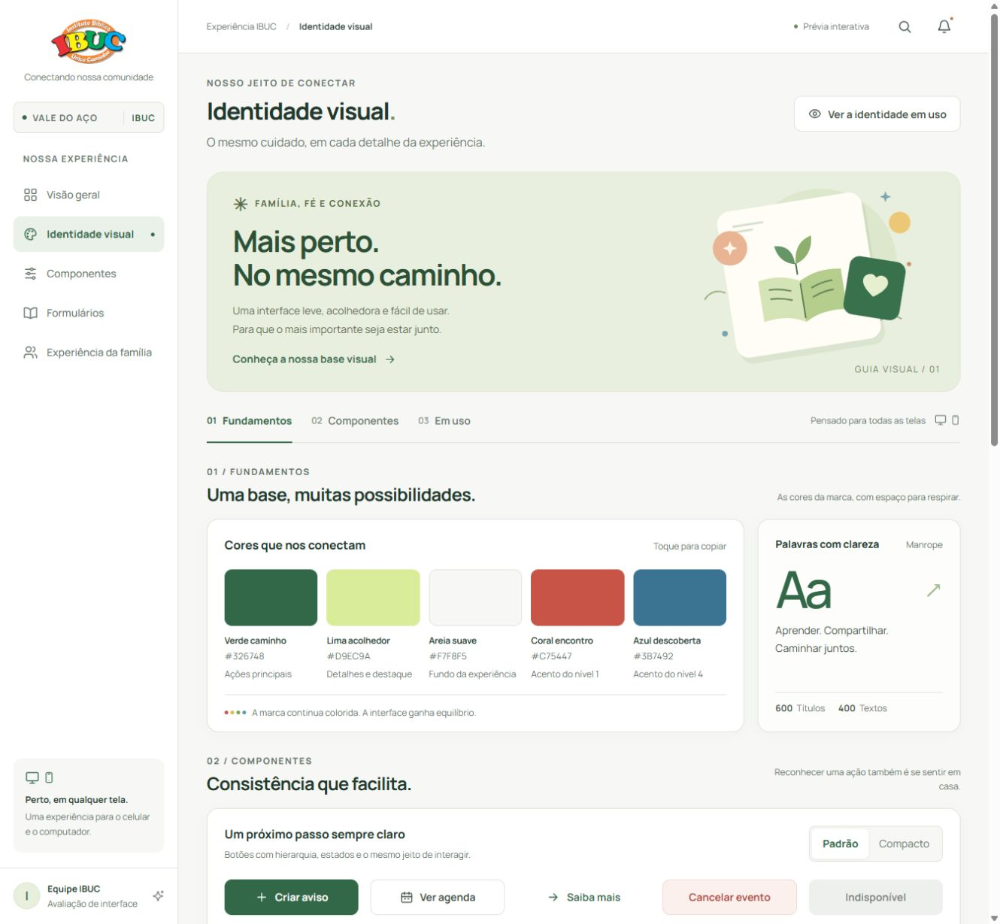
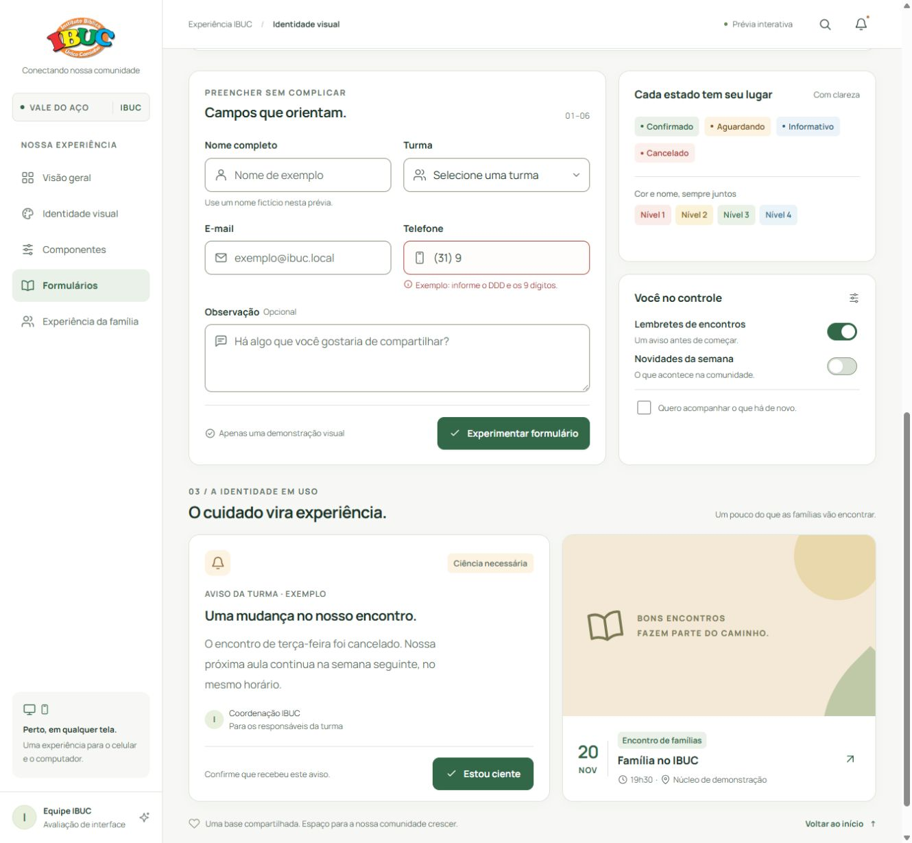

# Sistema IBUC

Sistema em desenvolvimento para aproximar famílias, colaboradores e igrejas participantes do IBUC. O projeto prevê administrações regionais independentes, comunicação com confirmação de ciência, agenda, presença e acompanhamento pedagógico.

A entrega implementada apresenta a identidade visual em Laravel: cores, tipografia, ícones automáticos nos campos e componentes de formulário, botões, avisos e diálogos adaptados ao computador e ao celular. Os exemplos usam dados fictícios; os módulos de negócio estão descritos no roteiro.





## Executar a prévia

Requisitos: PHP 8.3 ou 8.4 com as extensões do Laravel, Composer 2, Node.js 22.12 ou superior e npm. A prévia não precisa de PostgreSQL ou Redis: seu ambiente de demonstração usa sessão/cache temporários e não envia os formulários.

Clone o repositório e instale as dependências:

```powershell
git clone https://github.com/matheuswilliam95/ibuc-sistema.git
Set-Location -LiteralPath ibuc-sistema/sistema
composer install
```

Em uma instalação nova, prepare a configuração local:

```powershell
Copy-Item -LiteralPath .env.example -Destination .env
php artisan key:generate
npm ci
npm run build
```

Se já houver um `.env` local, mantenha-o. Para esta prévia, o ambiente deve ser `APP_ENV=local`, com `SESSION_DRIVER=array`, `CACHE_STORE=array` e `QUEUE_CONNECTION=sync`, conforme o exemplo versionado.

## Abrir no navegador

Na pasta `sistema/`, com as dependências instaladas:

```powershell
php artisan serve --host=127.0.0.1 --port=8000 --no-reload
```

Abra [a prévia visual](http://127.0.0.1:8000/identidade-visual). Para alterar CSS ou JavaScript, execute `npm run build` e recarregue a página.

Esse endereço é local à máquina que executa o Laravel. O repositório compartilha o código, a documentação e as imagens; ele não hospeda o servidor PHP. As rotas de demonstração estão disponíveis nos ambientes `local` e `testing`.

Consulte [o guia da identidade](docs/identidade-visual/GUIA.md) para instalar as dependências, reutilizar componentes e orientar as próximas telas.

## Seguir a implementação

O [roteiro de implementação](IMPLEMENTACAO.md) organiza as 46 entregas. A interface atual é a preparação visual da T04. As propostas T01–T03 estão prontas para avaliação: acesso, regras pedagógicas, dicionário de dados e autorizações. O usuário escolheu as faixas de 2–5, 6–8, 9–11 e 12–17 anos para o piloto; as demais decisões aplicáveis continuam identificadas. Os módulos de negócio e as verificações de autorização no servidor serão implementados na F1 e nas fases seguintes.

| Material | Conteúdo |
|---|---|
| [Aplicação Laravel](sistema) | Código da prévia e componentes compartilhados |
| [Guia visual](docs/identidade-visual/GUIA.md) | Cores, tipografia e uso dos componentes |
| [Roteiro](IMPLEMENTACAO.md) | Fases, dependências e critérios de aceite |
| [Matriz de acesso](docs/governanca/matriz-de-acesso.md) | Proposta T01 de permissões, nomeação e substituição, com decisões pendentes |
| [Regras pedagógicas](docs/governanca/regras-pedagogicas.md) | Proposta T02 de currículo, idade, matrícula, remanejamento e faltas |
| [Dados e privacidade](docs/governanca/dados-e-privacidade.md) | T03: campos, finalidade, hipótese legal em análise, leitores e retenção |
| [Responsabilidade e autorizações](docs/governanca/responsabilidade-e-autorizacoes.md) | T03: representação, retirada, ciência, imagem e minutas por finalidade |
| [Fontes e decisões](docs/governanca/fontes-e-decisoes.md) | Evidências dos anexos, referências oficiais e situação das escolhas institucionais |
| [Plano do sistema](<output/pdf/Plano de implantação do sistema IBUC.pdf>) | Planejamento funcional e técnico |
| [Backlog](<outputs/01a1da34-6809-7471-91a3-bee58d1ea8c0/Backlog de implantação IBUC.xlsx>) | Entregas e decisões acompanháveis |

## Verificar uma alteração

Execute dentro de `sistema/`:

```powershell
php artisan test
php vendor/bin/pint --test
npm run build
```

As instruções de desenvolvimento estão em [AGENTS.md](AGENTS.md). Credenciais, dependências, logs, banco de dados e arquivos gerados ficam fora do versionamento. A identidade e os materiais institucionais mantêm os direitos de seus respectivos titulares.
