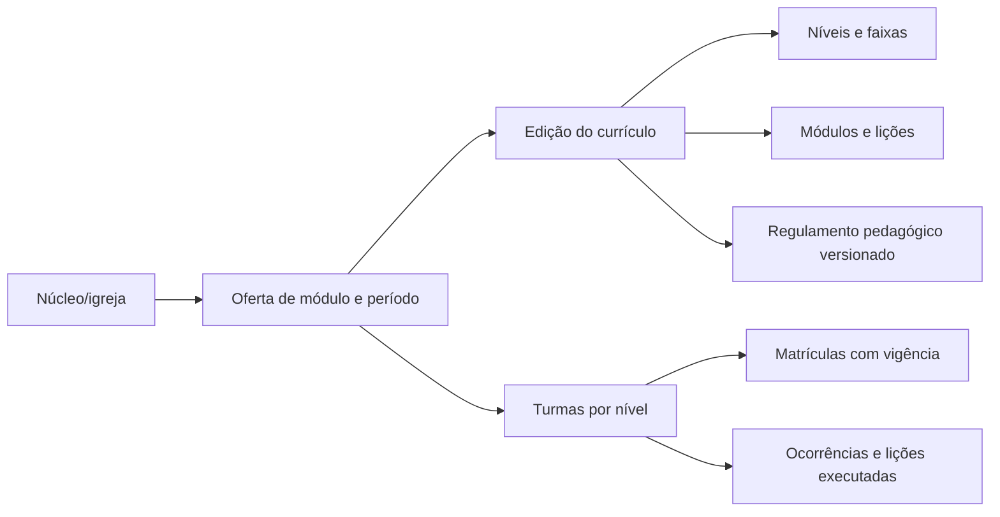

# T02 — Regras pedagógicas, matrícula e frequência

**Estado:** Em validação. **Versão:** proposta 1, de 14/11/2026. **Validação:** direção pedagógica, coordenação e secretaria. D02 está parcialmente definida: o usuário escolheu para o piloto as faixas 2–5, 6–8, 9–11 e 12–17 anos, em resposta no chat de 14/11/2026. Corte, transição e edição completa ainda dependem de definição; D05 permanece em aberto. A escolha não representa aprovação nacional nem habilita matrícula automática.

Esta proposta organiza currículo, idade, entrada, remanejamento e revisão de faltas para a implementação de T06/T10/T21/T22/T32. Reutiliza [a matriz T01](matriz-de-acesso.md). As fontes A1–A8 e as decisões estão detalhadas em [fontes e decisões](fontes-e-decisoes.md); referências locais não viram regra nacional por padrão.

## 1. O que os anexos definem e o que diverge

| Assunto | Evidência | Tratamento proposto |
|---|---|---|
| Estrutura | A6/pp. 2 e 5: dez módulos, dois/ano, 12 lições/módulo, uma aula/semana | Cadastrar como referência de uma edição; quantidade e ritmo não são constantes imutáveis no código. |
| Faixas | A6/p. 4: níveis 1 a 4 com 2–5, 6–8, 9–11 e 12–17 anos | Alternativa completa de configuração para a direção avaliar. |
| Público | A6/p. 2: 3–17; A7/p. 3: 2–14 | Divergência mantida explícita. Não deduzir uma tabela de níveis a partir apenas da faixa geral. |
| Entrada em andamento | A1/pp. 8–9: não matricular no módulo já iniciado; considerar nova turma | Solicitação pode ser recebida; matrícula fica em espera para próxima oferta ou para nova turma elegível. |
| Remanejamento | A1/p. 10: secretaria com coordenação, considerando faixa etária no ano | Exige escolher corte e momento efetivo. Não mover aluno automaticamente no aniversário. |
| Frequência | A1/p. 11: contato em cada falta sem justificativa e comunicação ao atingir 3 | Tarefa privada de contato e alerta distintos da revisão pedagógica. |
| Intensivão | A1/pp. 8–9: mais de 3 faltas, a cada seis lições e ao final do módulo | Gerar indicação para revisão humana no marco; não marcar reprovação ou recuperação concluída automaticamente. |
| Avaliação | A1/p. 11: sexta e última lição | Registrar marcos de avaliação de aprendizado separados dos alertas de faltas. |
| Planejamento | A7/p. 10 e A5/p. 3: seis momentos | Preservar os momentos com duração/horários por oferta; horários impressos não serão copiados para todas as unidades. |

## 2. Modelo para a T06

| Registro | Campos/relações necessários | Regra |
|---|---|---|
| Edição | Identificador, título, origem, versão, vigência, níveis, módulos e referência de aprovação | Publicar nova versão para mudar regra usada; conservar a anterior para o histórico. |
| Nível | Edição, código, nome e faixa de idade | Faixas não sobrepostas dentro da edição e sem lacunas no público declarado. Cor/nome não concedem acesso. |
| Módulo/lição | Edição, ordem, identificação e número de lições | Reposição referencia a mesma lição; não cria novo conteúdo concluído no denominador. |
| Regulamento | Regional, edição/versão, corte, transição, entrada, contagens, marcos e vigência | Rascunho sem aprovação não pode ser ativado. A oferta referencia a versão adotada. |
| Oferta | Regional/núcleo, módulo/edição, período, fuso, início efetivo, estado, capacidade e regulamento | Um início adiado não equivale a módulo já realizado; o início efetivo é registrado pela equipe autorizada. |
| Turma | Núcleo/oferta, nível, nome, capacidade e equipe atribuída | Turmas homônimas em unidades diferentes possuem identidade e consultas distintas. |
| Matrícula | Aluno, turma/oferta, início/fim, estado, regra aplicada e decisão | Não se confunde com pessoa ou conta. Uma matrícula ativa por aluno/oferta, sem sobreposição indevida de turma. |
| Remanejamento/transferência | Origem/destino, data efetiva, motivo, autor, aprovador e equivalência se houver | Encerrar vínculo anterior e abrir o novo na mesma operação, preservando chamadas e decisões anteriores. |

Oferta organiza a execução de um módulo por um núcleo/período; turmas a subdividem por nível e capacidade. Se um núcleo precisar iniciar nova turma mais tarde, criar oferta com início próprio em vez de adulterar a data da oferta já em andamento.

Separar o estado da **solicitação** (`rascunho`, `enviada`, `em análise`, `aguardando família`, `em espera`, `aprovada`, `recusada`, `cancelada`) do estado da **matrícula** (`ativa`, `transferida`, `encerrada`, `cancelada`). “Aprovada” só corresponde a matrícula ativa quando a operação de criação/vigência se completar. Conclusão de módulo é decisão pedagógica própria, não sinônimo de encerramento cadastral.

## 3. D02 — alternativas de idade e corte

| Alternativa | Configuração que pode ser preparada | Pendência |
|---|---|---|
| A — faixas da apresentação | N1: 2–5; N2: 6–8; N3: 9–11; N4: 12–17 | Confirmar adoção e resolver a descrição geral 3–17 da mesma apresentação. |
| B — público 3–17 da apresentação | Público geral 3–17 | A direção precisa confirmar a faixa do N1 e os demais níveis; não alterar silenciosamente 2 para 3. |
| C — público 2–14 do caderno | Público geral 2–14 | A direção precisa fornecer as faixas dos níveis e o destino de quem ultrapassa 14; não truncar o N4 automaticamente. |

**Escolha recebida para o piloto:** alternativa A, com N1 2–5, N2 6–8, N3 9–11 e N4 12–17, conforme orientação do usuário no chat de 14/11/2026. As alternativas B/C ficam documentadas como origem da divergência, sem serem usadas para enquadrar alunos no piloto. A seleção das faixas não escolhe corte, vigência, edição completa ou momento de remanejamento.

**Proposta de corte:** idade em anos completos na data de início efetivo da oferta/módulo, no fuso local. Guardar nascimento e a referência usada na decisão; idade exibida no perfil é calculada, não digitada ou usada para reescrever a matrícula antiga.

Alternativas: corte anual em dia/mês definido pela direção; ou remanejamento durante o módulo ao atingir a idade. A primeira simplifica estabilidade anual; a segunda demanda revisão de conteúdo, vaga e transição. Nenhuma regra de corte/remanejamento foi aceita nesta versão. A regra deve especificar aniversários em 29/02 e exceções pedagógicas justificadas; não importar um corte escolar externo sem escolha institucional.

**Proposta de remanejamento:** sugerir o próximo nível quando aplicável e efetivar na próxima oferta, após decisão de secretaria/coordenação. Se for autorizada mudança no meio do módulo, informar data efetiva, equivalência de lições e responsável pela acolhida. A sugestão do sistema não é uma transferência aprovada.

Exemplo fictício: criança nascida em 20/11/2020 tem 5 anos em 17/11/2026 e completa 6 em 20/11/2026. Com alternativa A e corte no início de uma oferta em 17/11, permanece no N1 nessa oferta. Com remanejamento por aniversário, seria candidata ao N2 após o aniversário; a mudança depende da regra escolhida e de revisão. Esse exemplo não decide D02.

Idade fora da faixa, nascimento ausente/inconsistente, ausência de corte ou de edição aprovada geram pendência para análise, sem enquadramento automático. Mudança de nível não descarta módulos/atividades já cursados nem implica aprovar conteúdo não realizado.

## 4. Entrada e movimentação

1. Receber solicitação do responsável verificado ou atendimento assistido. Conta aprovada não aprova matrícula; os poderes familiares vêm da T03/T09.
2. Secretaria confere criança, núcleo desejado, nascimento, representação e possíveis duplicidades sem revelar vínculos de outras unidades.
3. Consultar edição/regulamento adotados, oferta ainda não iniciada, faixa aplicável e capacidade. Se a referência estiver pendente, manter análise com motivo visível à secretaria.
4. Para módulo iniciado, oferecer espera para próxima oferta ou análise de nova turma/oferta com início próprio. Participação em evento aberto não cria matrícula retroativa ou acesso à turma.
5. Na aprovação, criar matrícula e registrar versão da regra, autor e vigência. Capacidade/duplicidade são revalidadas no banco; duas aprovações não ocupam a última vaga.
6. No remanejamento, apresentar origem, destino, início, vaga, conteúdo reconhecido e efeito no acesso. Exigir autorização de quem pode atuar nas unidades envolvidas.
7. Em transferência entre núcleos/regionais, origem emite informações mínimas autorizadas e destino aprova entrada. Uma conta não se torna visível em toda a rede. Saúde, imagem e documentos não são copiados automaticamente para novo contexto/finalidade.
8. Consultas de chamada usam matrícula vigente na data da ocorrência; acesso à consulta hoje exige vínculo atual. Transferência não altera presença histórica nem cria falta antes do início do novo vínculo.

Usar início inclusivo e fim exclusivo nos vínculos. Na mudança em um mesmo instante, a pessoa deixa a turma anterior e entra na nova sem uma dupla presença. Se houver mudança de edição ou lições sem equivalência, manter pendência de análise, sem supor aproveitamento ou zerar histórico silenciosamente.

## 5. Frequência e D05

### Qual registro pode entrar na contagem

| Situação | Presença/frequência | Efeito em alerta e revisão propostos |
|---|---|---|
| Aula realizada, aluno matriculado na data, presente | Uma presença por pessoa/ocorrência | Não soma falta. |
| Aula realizada, falta sem justificativa | Uma falta | Abre contato privado; soma no contador aprovado. |
| Aula realizada, falta justificada | Ausência identificada à parte; justificativa não vira presença | D05 escolhe sua inclusão em alerta e revisão, separadamente. |
| Chamada não lançada ou incompleta | Pendência de cobertura, não ausência presumida | Não consolidar contagem como final nem fechar com item pendente. |
| Cancelamento | Ocorrência preservada como cancelada | Não gerar falta, contato por ausência ou oportunidade de comparecimento. |
| Antes/depois da vigência da matrícula | Não elegível | Excluir da contagem; não criar falta retroativa. |
| Culto facultativo, reunião da equipe ou evento | Frequência própria por tipo | Não somar automaticamente a faltas de aula do módulo, mesmo se o evento for obrigatório. |
| Reposição/intensivão | Referência às lições cobertas e presença própria | Não apagar a ausência original; reconhecimento para revisão depende de D05 e decisão humana. |

**Proposta de apuração:** acumulado do módulo por aluno, incluindo histórico reconhecido da mesma edição/módulo ao mudar de turma. Outra alternativa é apuração por blocos de seis lições. A normativa não resolve a diferença com precisão; D05 precisa escolhê-la. Os contadores do relatório devem indicar período, regra/versão, quantidade sem justificativa, justificadas e pendências.

### Três resultados distintos

| Resultado | Condição da referência local | Proposta de comportamento |
|---|---|---|
| Contato de acolhimento | Cada falta sem justificativa, A1/p. 11 | Uma tarefa por aluno/ocorrência com professor responsável, tentativa, resultado e próximo contato. Sem diagnóstico ou exposição à turma. |
| Alerta à coordenação | Ao atingir 3 faltas, A1/p. 11 | Criar alerta quando cruzar o limiar segundo D05; não confundir “3” com “mais de 3”. Reenvios não duplicam a tarefa. |
| Revisão de intensivão | Mais de 3 faltas nos marcos de seis lições e final, A1/pp. 8–9 | Com quatro ou mais faltas contáveis, gerar indicação no marco elegível. Coordenação registra plano, lições a recuperar e decisão; sem reprovação automática. |

**Marcos:** referência de 12 lições gera revisão na 6ª e na 12ª/final, sem duas revisões iguais no mesmo marco. Se outra edição tiver quantidade diferente, explicitar os múltiplos de seis e a última lição. O marco é pedagógico, associado à lição executada, não à sexta data do calendário: cancelamento/adiamento não o antecipa. A finalização de chamadas pertinentes ou uma pendência explícita deve acompanhar a avaliação; não apresentar lista incompleta como resultado definitivo.

**Exemplo para escolher a regra:** 2 faltas sem justificativa + 2 justificadas na 6ª lição. Contando só as sem justificativa, há 2 e não há alerta de 3 nem revisão por mais de 3. Incluindo justificadas nos dois contadores, há 4, com alerta de limiar e indicação de revisão. A taxa de presença continua distinguindo as justificadas em ambos os casos.

Reposição não libera matrícula no próximo módulo por si só. Registrar comparecimento, lições e avaliação da coordenação. Uma correção de chamada recalcula os indicadores e marca alertas superados, sem apagar tentativas de contato ou decisões já registradas. Repetir fechamento/correção não duplica presença, tarefa ou alerta da mesma regra/versão e marco.

## 6. Planejamento e conclusão

Na T32, usar os seis momentos: acolhida, memorização do versículo, Bíblia em foco, praticando a Bíblia, hora da novidade e hora da bênção. Guardar previsto e executado por lição; avaliação de aprendizado na sexta/última não será substituída por confirmação de leitura ou presença.

As atividades do IBUC em Casa na T31 são individuais por aluno/semana, vinculadas à edição/nível/lição. Cumprir uma atividade de Lucas não marca a de Lia. Vídeo familiar é facultativo e privado à equipe habilitada; sua entrega não concede licença de publicação. Moedas pedagógicas não geram crédito financeiro.

A conclusão registra edição/módulo, lições reconhecidas, avaliações aplicáveis, recuperação e decisão da equipe. Critérios de aprovação e emissão de comprovação precisam de definição pedagógica; não inventar nota de corte ou percentual de frequência a partir dos anexos.

## 7. Casos preparados para validação

Resultados esperados da proposta, ainda sem implementação/teste funcional no Laravel.

| Caso | Situação fictícia | Resultado esperado |
|---|---|---|
| P01 | Alternativa A, limite de 5/6, 8/9, 11/12 e 17/18 anos na data de corte | Uma faixa por idade elegível; fora do público vai à análise. Testar as duas datas ao redor de cada aniversário. |
| P02 | Edição sem escolha de faixas/corte, criança com idade conhecida | Não aprovar enquadramento automático nem escolher uma fonte silenciosamente. |
| P03 | Criança faz aniversário no módulo | Manter matrícula conforme versão adotada e sugerir análise; não reescrever chamadas. |
| P04 | Nascimento em 29/02 e corte em ano não bissexto | Exigir regra explícita de D02 e conferir resultado no dia anterior e posterior ao limite. |
| P05 | Responsável solicita entrada após início efetivo da oferta | Receber solicitação e encaminhar espera/nova oferta; não criar matrícula retroativa. |
| P06 | Duas aprovações concorrem pela última vaga | Uma matrícula ocupa a vaga; a outra segue o fluxo aprovado de espera. |
| P07 | Lia troca de Jardim/Sementes para outra turma no instante definido | Chamada anterior permanece em Jardim; nova ocorrência usa a turma vigente; sem dupla presença. |
| P08 | Lucas tem 2 faltas contáveis e recebe a terceira | Criar alerta à coordenação uma vez; ainda não atende “mais de 3”. |
| P09 | Lucas tem 4 faltas contáveis na 6ª lição | Indicar revisão de intensivão; sem declarar recuperação concluída ou reprovação. |
| P10 | Há 4 faltas, mas a sexta aula do calendário foi cancelada antes de executar a lição 6 | Excluir o cancelamento e aguardar o marco pedagógico real. |
| P11 | Duas faltas sem justificativa e duas justificadas | Apresentar o efeito das alternativas da seção 5, identificando D05 pendente. |
| P12 | Terça de culto facultativo e reunião da equipe | Gerar listas próprias, sem aumentar faltas de aula. |
| P13 | Uma chamada tem estado não lançado | Mostrar cobertura incompleta; não contar falta nem fechar a lista. |
| P14 | Correção transforma a terceira falta em presença | Recalcular contador/alerta, preservar histórico e exigir autor/motivo. |
| P15 | Uma reposição aborda a mesma lição e recebe dois envios por queda de conexão | Uma execução reconhecida da lição; ausência original preservada e decisão humana rastreável. |
| P16 | Transferência muda de edição ou ocorre entre regionais | Conferir equivalência e representação no destino; não revelar ficha da origem ou zerar faltas automaticamente. |

## 8. Pendências e passagem

- [x] Edição, oferta, turma, matrícula e vigência modeladas documentalmente.
- [x] Divergência etária e alternativas de corte/remanejamento explicitadas.
- [x] Contato, alerta de 3, revisão com mais de 3 e avaliações separados.
- [x] Casos de limite preparados para a validação.
- [x] D02, parcela de idade: faixas da alternativa A escolhidas pelo usuário para o piloto em 14/11/2026.
- [ ] D02: corte, transição, vigência e edição completa aprovados pela área responsável.
- [ ] D05: faltas justificadas, janela, reposição e transferência decididas.
- [ ] Critérios de conclusão pactuados antes de habilitar aprovação automática.

As decisões permanecem registradas em [fontes e decisões](fontes-e-decisoes.md). A T06 pode ser preparada com configurações fictícias/rascunhos, sem apresentar nenhuma alternativa como regulamento adotado pela regional.
