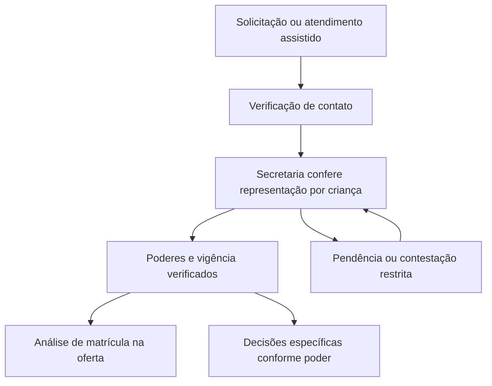

# T03 — Responsabilidade, retirada e autorizações

**Estado:** Em validação. **Versão:** proposta 1, de 14/11/2026. **Validação:** secretaria, privacidade, direção e mídia conforme a decisão. D03/D04/D06/D09/D12 permanecem em aberto. Os textos abaixo são minutas para revisão e protótipo com dados fictícios, não termos jurídicos publicados ou aceitos por participantes.

Este documento complementa [o dicionário de dados](dados-e-privacidade.md) e [a matriz T01](matriz-de-acesso.md). As referências das fichas, normativa e legislação estão em [fontes e decisões](fontes-e-decisoes.md). Nenhuma instrução dos anexos autoriza importar cadastros, presumir consentimento ou enviar mensagens em nome da equipe.

## 1. Conceitos que precisam permanecer separados

| Registro | O que comprova | O que não comprova |
|---|---|---|
| Contato verificado | Controle daquele e-mail/telefone no procedimento usado | Identidade civil, guarda ou poder sobre criança. |
| Vínculo de responsabilidade | Relação verificada, poderes e vigência por criança | Acesso a colegas, outros núcleos ou todos os poderes possíveis. |
| Contato de emergência | Destinatário para contato necessário | Representação, consentimento de imagem, inscrição ou acesso ao portal. |
| Autorização de retirada | Pessoa habilitada a buscar determinada criança no alcance/prazo | Poder de acompanhar dados, inscrever ou decidir imagem. |
| Solicitação de matrícula | Intenção e dados necessários para análise | Matrícula aprovada, conta infantil ou autorização de mídia. |
| Confirmação de ciência | Ator tomou ciência da obrigação e versão identificadas | Presença no evento, concordância com termo ou consentimento para outra finalidade. |
| Consentimento de imagem | Manifestação específica do titular/representante habilitado | Publicação automática, liberação de terceiros na foto ou licença para qualquer canal. |
| Termo de voluntariado | Manifestação referente ao vínculo institucional descrito | Nomeação automática, acesso à turma ou licença de imagem. |

## 2. Conta restrita e vínculo familiar — D03

1. **Entrada:** convite de uso único com expiração, pedido direcionado ao núcleo ou acolhimento presencial. Código do núcleo indica destino, sem aprovar usuário ou revelar cadastros existentes. Conta pendente acompanha apenas a própria solicitação, com resposta que não enumere pessoas da rede.
2. **Contato:** verificar o canal do adulto; oferecer via assistida para quem não usa aplicativo. Não exigir conta ou e-mail próprio da criança. Verificação de novo telefone não transfere vínculos familiares para seu portador.
3. **Representação:** secretaria designada confere identidade e poder referente a cada criança pelo procedimento aprovado em D03. Tipos de evidência, necessidade de cópia, revisor e prazo serão definidos pela área; não coletar dossiê completo por padrão nem aprovar por parentesco declarado.
4. **Poderes:** registrar separadamente acompanhar, confirmar ciência, inscrever, decidir imagem e autorizar retirada. Uma ação só existe se o poder foi verificado e estiver vigente. Parentesco, pessoa autorizada a buscar e contato de emergência podem existir sem conta ou representação.
5. **Ativação:** registrar criança, adulto, poderes, início/fim, verificador, evidência mínima e regra usada. A ativação de conta, do vínculo e da matrícula são decisões distintas. A família recebe situação compreensível sem acesso à documentação de outros adultos.
6. **Atualização:** adulto solicita inclusão/correção; a secretaria verifica poderes, sem autoconcessão. Nova evidência que afete guarda segue revisão humana restrita; o sistema não interpreta ordem judicial nem decide conflito de guarda.
7. **Contestação:** abrir protocolo restrito com responsável pelo atendimento. Suspender concessões/publicações/retiradas que dependam do poder efetivamente controvertido e encaminhar à área competente, conforme procedimento aprovado. Não ampliar acesso nem expor a alegação à turma. A equipe define o tratamento dos poderes não controvertidos com base na evidência vigente e no melhor interesse; não há bloqueio indiscriminado de toda a família por uma denúncia.
8. **Revogação/expiração:** encerrar o poder aplicável e revalidar próximas ações, sessões, filas e downloads. Preservar prova mínima das decisões anteriores pelo prazo aprovado, sem manter acesso atual só por existir histórico.

**Proposta para verificação assistida:** registrar operador, data, canal, evidência conferida e poderes verificados, com manifestação do adulto quando cabível. Operador atua na própria conta; não usa senha do responsável. Não transformar digitalização de assinatura em único modo de comprovação nem copiar documento para conversa/WhatsApp.

## 3. Retirada e saída autorizada — D03

- O representante com poder de autorizar retirada indica pessoa, criança, alcance, período e eventuais ocorrências. A secretaria verifica o pedido segundo o protocolo; o registro fica pendente até a conferência aplicável.
- A pessoa autorizada não precisa receber uma conta. O operador vê nome/identificação mínima, instrução operacional vigente e autorização válida para aquela criança/data; não o dossiê de guarda.
- Na entrega, registrar criança, ocorrência, adulto recebedor, operador, horário e referência da autorização usada. Conferência presencial segue procedimento aprovado; QR code ou indicação no aplicativo não substituem a identificação exigida.
- Pessoa não cadastrada, autorização expirada, instrução contraditória ou mudança de última hora geram encaminhamento à equipe responsável. Não aprovar automaticamente apenas por foto, mensagem ou conhecimento informal.
- Saída desacompanhada, quando cabível, precisa de regra e autorização próprias em D03/D12. Campo de observação, ciência de aviso ou autorização de imagem não suprem essa decisão.

## 4. Ciência e atendimento assistido — proposta para D04

**Recomendação para avisos de alunos:** uma obrigação por criança e versão do aviso, satisfeita por um representante habilitado, sem exigir confirmação de todos os seus responsáveis. Para avisos pessoais de colaboradores, uma obrigação por pessoa. A direção pode escolher outro modelo por tipo de aviso; a publicação identifica a regra escolhida, sem alterá-la retroativamente.

Exemplo fictício: Bruno representa Lucas e Lia. Um aviso atinge os dois. Confirmar Lucas não confirma Lia. Se a tela oferecer “Confirmar para os dois”, deve mostrar os nomes e registrar duas obrigações de forma explícita. Reenvio/duplo toque mantém os mesmos registros. Se Ana também puder confirmar Lucas, sua manifestação é registrada sem duplicar a obrigação satisfeita.

Publicação guarda destinatários elegíveis, versão e regra. Alteração material cria nova versão e novas pendências aplicáveis, preservando o que foi confirmado antes. Abrir, receber push e participar do encontro não acionam “Estou ciente”. Vínculo revogado não recebe conteúdo em fila; a operação identifica obrigações dispensadas/reencaminhadas em vez de manter um responsável sem poderes como destinatário acessível.

**Atendimento sem aplicativo:** registrar uma tentativa de contato separada, operador, adulto contatado, versão apresentada e resultado. Proposta de estados: sem contato, mensagem deixada, orientação transmitida e ciência assistida declarada. Somente o último, com evidência do procedimento aprovado, pode satisfazer a obrigação por via assistida. Mostrar sua origem no relatório; nunca fabricar clique ou assinatura do pai. D04 define se e como essa modalidade será aceita.

## 5. Imagem e mídia — D09

### Decisões separadas

| Finalidade | Quem pode decidir | Condição proposta |
|---|---|---|
| Foto restrita de identificação no perfil | Adulto titular ou representante habilitado | Opcional e separada de galeria; não usar como capa pública. |
| Captação em atividade/evento | Titular ou representante com poder de imagem | Informar ocasião, tipos de registro e prazo. Ausência/recusa orientam a equipe a evitar captação identificável. |
| Galeria interna | Titular/representante habilitado de cada pessoa identificável | Peça/versão, audiência da turma/igreja/evento e prazo explícitos. |
| Canal externo | Mesmos decisores habilitados | Canal concreto e finalidade identificados; aprovação interna não migra para Instagram, site ou outra rede. |
| Atividade/vídeo familiar entregue ao professor | Participante/representante na finalidade pedagógica | Entrega privada; divulgar em galeria exige nova avaliação/decisão de imagem. Vídeo é facultativo. |

D09 precisa definir o procedimento quando houver mais de um representante habilitado. Não pressupor que sejam obrigatórias duas assinaturas para toda família nem que o primeiro “sim” vença uma recusa. Conflito, pessoa sem representante verificado ou pessoa não identificada bloqueiam a liberação da peça até tratamento pela área competente.

### Da captação à retirada

1. Conferir permissões de captação e orientar a equipe antes da atividade. A publicação não corrige uma captação não autorizada.
2. Receber arquivos em área privada, validar tipo/tamanho e remover geolocalização. Manter estado de revisão; sem original/miniatura acessíveis ao público.
3. Identificar manualmente todas as pessoas reconhecíveis. Sem reconhecimento facial. Não presumir autorização por uniforme, participação no evento ou por constar em foto antiga.
4. Preparar prévia protegida por pessoa/família, sem expor terceiros indevidamente. Quando necessário, ocultar terceiros na prévia; a decisão continua vinculada à versão final, contexto e audiência identificados. A equipe deve verificar que a prévia permite entender o uso proposto.
5. Obter decisões específicas e revisar editorialmente. Peça com três crianças exige situação resolvida para as três, além dos adultos identificáveis. Falta de decisão não é consentimento.
6. Publicar somente depois de verificar novamente poderes, decisões, versão, finalidade, canal e prazo. Revalidar também no processamento em fila. Alteração relevante de peça, audiência ou uso exige nova avaliação.
7. Revogação/expiração retira acesso ao original, miniaturas, capa e segmentos de vídeo servidos. Suspender distribuição e registrar ações nos canais externos administrados; acompanhar pedidos que dependam de terceiros, sem prometer apagar cópias já feitas por eles.
8. Conservar somente a evidência mínima justificada e aplicar R07/R08. Recusa ou revogação não cancelam matrícula, atividades ou atendimento.

## 6. Adolescente, maioridade e colaboração — D12/D06

A proposta mínima atende a criança pela conta do representante e pela equipe, sem conta infantil. Para adolescente, habilitar somente após definir idade/forma de verificação, supervisão, ações e prazos, considerando o enquadramento do serviço no ECA Digital. A proposta não presume que uma simples caixa “sou responsável” ou a idade autodeclarada sejam suficientes. [Orientações oficiais da ANPD sobre ECA Digital](https://www.gov.br/anpd/pt-br/assuntos/eca-digital).

Uma eventual delegação pode permitir consultar conteúdo próprio, entregar atividade e inscrever-se em eventos autorizados. Não permite representar irmãos, conceder poder a adulto, administrar equipe ou assumir consentimentos reservados ao representante. Revogação pelo concedente habilitado, término do vínculo ou da vigência encerram a ação na próxima operação; registrar versão e poderes vigentes na manifestação.

Ao atingir maioridade, encaminhar revisão de representação/conta para não prolongar poderes parentais incompatíveis. Não conceder novo acesso ou licença de imagem por mera passagem de data. O fluxo aprovado deve tratar direitos do agora adulto, comprovação e continuidade do atendimento, sem transferir senha ou apagar histórico.

**Colaborador:** convite nominal, atribuição com escopo/vigência e termo de voluntariado separados de imagem. A normativa A1/p. 10 pede certidão em janeiro; D06 deve verificar o enquadramento no art. 59-A do ECA, periodicidade e custódia. O sistema poderá lembrar atualização e registrar conferência; não fará decisão automatizada de aptidão com base em certidão ou saúde.

## 7. Minutas para os protótipos da T04

Os campos entre colchetes precisam ser preenchidos e aprovados antes de publicação real. Registrar identificador, versão e data do texto integral apresentado, finalidade, campos, canal/audiência, escopo, prazo, autor/revisor e estado. Minuta e versão não publicada não podem ser aceitas como termo vigente. Alterar termo para novos pedidos não muda a evidência de versões anteriores.

### Aviso de privacidade da matrícula

> [CONTROLADOR E UNIDADE RESPONSÁVEL] utilizará os dados indicados neste cadastro para analisar a matrícula, organizar a turma e prestar o atendimento descrito. Você pode consultar as finalidades, quem tem acesso e os prazos em [AVISO COMPLETO]. O canal [CONTATO DE PRIVACIDADE] atende pedidos sobre seus dados e os da criança que você representa. Informações de cuidado e decisões de imagem são apresentadas separadamente. Recusar divulgação de imagem não impede a matrícula. Se precisar, solicite atendimento assistido em [CANAL DO NÚCLEO].

Apresentar o aviso antes da coleta, com linguagem acessível à família e à idade do participante. “Li o aviso” é ciência sobre a informação, não a hipótese legal de todas as operações. Se a base aprovada exigir consentimento, apresentar manifestação específica daquela finalidade, com consequência da recusa e alternativa aplicável; não reunir tudo em “aceito os termos”.

### Solicitação de matrícula

> Solicito a análise da matrícula de [CRIANÇA] em [NÚCLEO/OFERTA]. Confirmo os dados que informei e estou ciente de que a secretaria verificará minha representação, a vaga e as regras pedagógicas antes de aprovar a matrícula.

Não anexar autorização de imagem a esse botão. Não exigir que a família declare uma guarda ou poder que ainda será verificado.

### Informação de cuidado

> Desejo informar à equipe designada as seguintes orientações necessárias ao cuidado de [CRIANÇA] nesta atividade: [ORIENTAÇÃO MÍNIMA]. A finalidade, os leitores e o prazo estão descritos em [AVISO ESPECÍFICO]. Posso pedir correção ou revisão em [CANAL].

Mostrar somente campos aprovados e manifestação própria quando a base exigir. Não marcar ausência de alergia quando a família não responder. Não solicitar prescrição ou autorizar medicação pelo campo de observação. Eventual necessidade de cuidado será discutida com a equipe, sem exclusão automática por recusa ou condição de saúde.

### Autorização de retirada

> Solicito autorização para que [PESSOA IDENTIFICADA] busque [CRIANÇA] em [OCORRÊNCIA OU PERÍODO], no [NÚCLEO]. A equipe verificará o pedido e a identidade no momento da saída, conforme o procedimento informado. Esta solicitação não concede acesso ao perfil ou decisões sobre imagem.

A solicitação só se torna autorização operacional após a verificação aplicável e a definição de vigência. Registrar recusa, alteração ou revogação separadamente.

### Decisão de imagem

> Para [PESSOA], decido sobre o uso da peça [PRÉVIA/VERSÃO] com a finalidade [FINALIDADE], para [AUDIÊNCIA], no canal [CANAL], até [PRAZO]. Posso recusar ou solicitar retirada pelo [CANAL DE PRIVACIDADE], sem prejuízo da matrícula ou participação.

Oferecer **Autorizar** e **Não autorizar** com clareza e sem seleção prévia. Captação, galeria interna e cada canal externo aparecem separadamente. No termo externo, explicar alcance público, compartilhamentos e limites de retirada de cópias de terceiros. O adulto titular manifesta por si; representante precisa do poder correspondente sobre a criança.

### Ciência de aviso

> Confirmo que tomei ciência do aviso [TÍTULO/VERSÃO], referente a [CRIANÇA OU OBRIGAÇÃO].

Mostrar a versão e o destinatário representado junto ao botão. Essa manifestação não inscreve em evento, não marca presença e não autoriza mídia. Para ciência assistida, usar registro específico do operador e o procedimento de D04.

### Delegação ao adolescente

> Solicito habilitar [ADOLESCENTE] para [AÇÕES DELIMITADAS], no [ESCOPO], de [INÍCIO] até [FIM]. Posso solicitar revogação em [CANAL]. As demais decisões permanecem sujeitas à representação e às regras informadas.

Minuta indisponível para uso real enquanto D12 e verificações aplicáveis não estiverem definidos. Não conceder todos os poderes do representante nem criar mensagem privada adulto-menor.

## 8. Direitos, correção, revogação e eliminação

1. Disponibilizar canal no portal e via assistida, com protocolo. Verificar identidade e poder relacionado ao pedido antes de fornecer dados; não exigir cópia de documento sem necessidade.
2. Identificar pessoas, campos, finalidade e contextos afetados. Exportação do titular não pode revelar documentos/contatos privados de outro responsável, respostas de outras famílias ou dados de colegas.
3. Direcionar correções ao operador competente, mantendo a evidência necessária: cadastro/representação na secretaria; presença com autor/motivo; orientação de cuidado ao informante/equipe designada.
4. Revogação de imagem ou poder aplica retirada/restrição sem esperar o ciclo periódico de descarte. Eliminação precisa considerar conservação permitida, obrigação concreta e limites técnicos; resposta não promete apagar prova que precise ser mantida, nem usa uma exceção para conservar tudo.
5. Registrar decisão, fundamento, prazo aplicável, execução e resposta, sem copiar o conteúdo sensível ao log. Encaminhar correção/retirada aos operadores e canais administrados pertinentes; restauração de backup reaplica as restrições antes de disponibilizar dados.

Para confirmação de existência/acesso, o art. 19 da LGPD distingue resposta simplificada imediata e declaração completa em até 15 dias. Esse prazo não será rotulado como prazo universal para qualquer pedido de eliminação/correção. A equipe deve mapear o prazo legal aplicável ao tipo de solicitação e registrar o acompanhamento. [LGPD, arts. 18 e 19, no Ministério da Justiça](https://bibliotecadigital.mj.gov.br/bitstream/1/1642/4/LEI_2018_13709.html).

## 9. Casos preparados para validação

| Caso | Situação fictícia | Resultado esperado na implementação futura |
|---|---|---|
| AUT01 | Ana verifica telefone e pede vínculo com Lucas | Contato é verificado; representação ainda precisa da conferência de D03. |
| AUT02 | Ana é professora em Jardim e mãe de Lucas em Ponte | Contextos separados; vê o dependente pela família sem consultar colegas ou assumir cargo em Ponte. |
| AUT03 | Adulto é contato de emergência e autorizado a buscar Lia | Sem poder automático de acompanhar, confirmar ciência ou decidir imagem. |
| AUT04 | Bruno confirma aviso para Lucas, também tendo poder sobre Lia | Na proposta D04, obrigação de Lia permanece pendente até manifestação própria/ação explícita para ambos. |
| AUT05 | Secretaria telefona e não consegue falar com o adulto | Registro de tentativa, sem satisfazer ciência ou fabricar assinatura. |
| AUT06 | Representante recusa imagem e solicita matrícula | Matrícula continua em análise normal; bloquear a publicação relacionada à recusa. |
| AUT07 | Foto tem três crianças; apenas duas têm decisão válida | Nem capa/miniatura é publicada; tratar pessoa pendente antes de liberar. |
| AUT08 | Galeria interna foi autorizada e mídia tenta postar em rede social | Exigir decisão específica do canal externo e versão; aprovação interna não basta. |
| AUT09 | Pessoa autorizada para retirada chega após o fim da autorização | Encaminhar à equipe conforme protocolo, sem liberação automática ou exposição do dossiê. |
| AUT10 | Há conflito sobre poder de imagem | Suspender publicação dependente e encaminhar revisão humana restrita; não escolher o primeiro “sim”. |
| AUT11 | Vídeo do IBUC em Casa é entregue ao professor | Manter privado e facultativo; não inserir na galeria por ter sido entregue. |
| AUT12 | Adolescente tenta inscrever-se sem delegação vigente | Negar ação e orientar ao representante/canal assistido, sem conceder poderes por idade declarada. |
| AUT13 | Termo é editado após manifestações anteriores | Preservar versão/evidência anteriores; avaliar nova manifestação para nova finalidade/uso. |
| AUT14 | Adulto pede dados, mas seu poder sobre a criança foi revogado | Verificar o pedido e poderes atuais; não entregar automaticamente a ficha pelo histórico. |
| AUT15 | Operador perde atribuição com retirada/publicação ainda em fila | Revalidar e interromper ação dependente; não confiar em permissão antiga ou sessão aberta. |
| AUT16 | Responsável por imagem revoga e arquivo já circulou externamente | Retirar canais/derivados administrados e registrar providências a terceiros, sem promessa de eliminação universal. |

## 10. O que falta para uso real

- [x] Fluxos e minutas separados por finalidade, com casos de revisão preparados.
- [x] Guarda, cuidado, retirada, ciência e imagem com poderes/visibilidade distintos.
- [ ] D03: procedimento de representação, evidências, contestação e retirada validado.
- [ ] D04: unidade e ciência assistida escolhidas por tipo de aviso.
- [ ] D06/D11: controlador, bases, leitores, retenção e operadores definidos.
- [ ] D09: prévia protegida, canais, quórum e retirada de mídia validados.
- [ ] D12: regras e enquadramento de conta/delegação a menor avaliados.
- [ ] Textos preenchidos, revistos e publicados nas versões aplicáveis; nenhum campo institucional pendente.

As verificações no servidor e as evidências operacionais serão implementadas nas T07–T16 e nos módulos correspondentes. A revisão destes documentos não substitui consentimento de participantes ou teste de um fluxo real.
