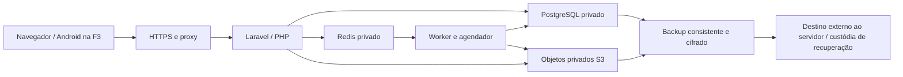

# T05 — Infraestrutura e custos do piloto

**Estado:** Em validação. **Consulta de preços:** 14/11/2026. **Decisão recebida:** o piloto contempla 100–300 alunos e já existe um servidor Hetzner; especificações e localização serão informadas posteriormente. Não houve acesso remoto, instalação, contratação ou alteração de DNS/recursos.

O caminho principal é **aproveitar o servidor existente se houver capacidade e isolamento adequados**, mantendo arquivos privados fora do diretório público e cópia de recuperação fora desse servidor. O [plano do piloto](../piloto/PLANO-DO-PILOTO.md) define a operação; o [procedimento de recuperação](RECUPERACAO-E-OPERACAO.md) define os ensaios necessários. D07/D08/D11 continuam pendentes de suas áreas responsáveis.

## 1. Inventário a completar quando o usuário fornecer os dados

| Informação | Estado atual | Para que será usada |
|---|---|---|
| Tipo de produto: Cloud, dedicado ou gerenciado | Não informado | Escolher implantação e opções de backup compatíveis; não aplicar instruções de Cloud a dedicado sem conferir |
| Localização/região e rede | Não informadas | Medir latência do público no Brasil, tráfego e avaliar tratamento/armazenamento com privacidade |
| Arquitetura CPU, núcleos e memória | Não informados | Reservar recursos e validar dependências/containers, inclusive se ARM |
| Discos, volumes e espaço livre | Não informados | Dimensionar PostgreSQL, temporários e backup; listar volumes não cobertos pelo provedor |
| Sistema operacional e suporte de segurança | Não informado | Validar PHP 8.4 e rotina de atualização sem supor reinstalação |
| Outros serviços, bancos e cargas no host | Não informados | Evitar disputa de recursos e intervenções em outros projetos |
| Painel, proxy, certificados, containers ou processos existentes | Não informados | Integrar a aplicação à estrutura existente, sem trocar a stack automaticamente |
| Backup contratado, retenção, destino e teste de recuperação | Não informados | Aproveitar somente cópias verificadas; distinguir snapshot, volume e backup do banco |
| Custo do servidor, moeda, cobrança e tráfego incluído | Não informados | Separar custo total, rateio do IBUC e custo incremental |
| Responsável pela conta, suplente e rotina de acesso | A confirmar em D07/D11 | Acesso nominal, manutenção e continuidade, com segredos em canal privado |
| Domínio e provedor de e-mail transacional disponíveis | Não informados | Verificação de contato, recuperação de conta e implantação HTTPS |

Não solicitar envio de `.env`, senha, chave SSH privada ou código MFA no chat/repositório. O levantamento inicial será de leitura, com escopo e acesso definidos pelo custodiante. No repositório público ficam apenas resultados técnicos sem identificadores administrativos sensíveis.

## 2. Ambientes separados

| Ambiente | Dados e finalidade | Separação exigida |
|---|---|---|
| Desenvolvimento | Código e pessoas fictícias; prévias locais atuais | PostgreSQL/Redis e armazenamento próprios quando introduzidos na F1; arquivos privados de desenvolvimento fora do OneDrive |
| Testes/CI | Dados efêmeros; nenhuma conta real | Banco exclusivo de teste, mensagens interceptadas, sem credenciais de produção; concorrência exercitada em PostgreSQL |
| Homologação | Ensaio com dados fictícios e recuperação | Processo/conta de serviço, banco, Redis, diretórios e credenciais de arquivos independentes; entrada controlada e sem envios a famílias |
| Produção | Somente dados reais liberados para o piloto | Domínio HTTPS, depuração desativada, administração nominal/MFA, cópias e monitoramento verificados; demonstrações `/identidade-visual` e `/jornadas` ausentes |

Preferir homologação em VM/ambiente isolado. Se a máquina física existente também a hospedar, registrar a falha física compartilhada e limitar recursos/processos; isolamento lógico não cria alta disponibilidade. Não usar o mesmo banco com nomes de tabela diferentes como separação entre testes e produção.

A configuração local de demonstração, com sessão/cache em memória e fila síncrona, não é a configuração de produção. A F1 deve configurar persistência, filas, arquivos privados e segredos por ambiente, sem copiar credenciais para os arquivos versionados.

## 3. Arquitetura proposta no Hetzner



Aplicação, PostgreSQL e Redis podem iniciar no host existente, com usuários/processos e limites próprios, após levantamento. Banco e Redis não terão portas públicas; administração usa o acesso restrito acordado com o custodiante. O servidor HTTP aponta apenas para `sistema/public`; o código, configuração e documentos privados não são publicados como diretório estático.

Worker processa notificações/arquivos com revalidação de vínculo; agendador roda uma única instância lógica das tarefas. Antes da F2, implementar outbox, retentativas e chaves de idempotência previstas no roteiro. A fila não será o único registro de aviso/ciência, nem cache a fonte de verdade. Dependências e versões serão fixadas e verificadas na F1, incluindo PHP 8.4 como alvo do ambiente definitivo e PostgreSQL suportado.

**Arquivos:** proposta principal de Object Storage compatível com S3, com buckets privados e projetos/credenciais independentes para produção e homologação. A leitura passa pela autorização do Laravel também para capa, miniatura e vídeo. Não criar URL pública ou depender só da validade de link assinado quando a retirada precisar ser imediata.

Na Hetzner, chaves S3 alcançam por padrão todos os buckets do mesmo projeto; projetos separados e políticas explícitas precisam ser conferidos com leitura/escrita permitidas e negadas. O fornecedor documenta limitações de políticas, portanto não copiar uma política AWS presumindo compatibilidade completa. [Documentação de credenciais S3 da Hetzner](https://docs.hetzner.com/storage/object-storage/faq/s3-credentials/).

Arquivos do PostgreSQL devem ficar em disco adequado do servidor, não em bucket ou Storage Box montado como banco. Essa distinção é indicada na [comparação oficial de armazenamento da Hetzner](https://docs.hetzner.com/storage/general/which-storage-is-right-for-me/).

## 4. Capacidade de referência, ainda sem teste de carga

| Item | Hipótese de dimensionamento | Verificação antes de adotar |
|---|---|---|
| Alunos | 100–300, conforme usuário | Distribuição por núcleo/idade e demanda real |
| Contas adultas | Até 600 responsáveis + 40 colaboradores, com possíveis sobreposições | Criança sem login; vínculos e irmãos não exigem contas duplicadas; contas de menores dependem de D12 |
| Simultaneidade | Ensaio inicial de 30 usuários, com picos de entrada no horário dos encontros | Medir cenário representativo, consultas e fila; total de alunos não é simultaneidade |
| Reserva inicial para produção | Referência de 2 vCPU, 4 GB RAM e 80 GB SSD disponíveis ao IBUC | Proposta, não requisito comprovado nem descrição do servidor existente. Conferir recursos livres e efeito em outras aplicações |
| Homologação | Referência de 1 vCPU, 2 GB RAM e 40 GB SSD, fora da reserva de produção | Definir isolamento/localização e disponibilidade sem comprar VM nesta entrega |
| Banco | Orçar até 5 GB no cenário de 300 alunos | Medir tamanho/índices/logs e crescimento; usar dados fictícios no ensaio |
| Processamento | Um worker inicial, com limites e observação de memória/fila | Vídeo/transcodificação e cursos extensos exigirão nova avaliação nas fases próprias |

**Metas propostas de ensaio:** 30 usuários por 15 minutos, incluindo pico de cinco minutos; erro de requisição normal abaixo de 1%, latência p95 das ações usuais abaixo de 1,5 s e fila de avisos usuais abaixo de 60 s. Medir também pelo menos dois acessos móveis a partir do Brasil. São critérios para pactuação, não SLA ou desempenho alcançado. CPU, memória, disco e demais serviços precisam manter margem; mudar tamanho da máquina sem analisar consultas/fila não comprova capacidade.

## 5. Armazenamento e cópias: cenários para orçamento

Sem galerias identificáveis de menores no piloto e sem vídeo massivo. As quantidades são hipóteses de capacidade, não dados já armazenados ou limites definitivos de upload. A T14 fixará tipos/tamanhos e a T03, retenção por finalidade.

| Hipótese | Cenário de 100 alunos | Cenário de 300 alunos |
|---|---|---|
| Banco de referência | 1 GB | 5 GB |
| Arquivos correntes | 10 GB | 20 GB |
| Versões/objetos anteriores a considerar | 10 GB | 20 GB |
| Exportações completas do banco em 30 dias, duas por dia | 60 × 1 = 60 GB | 60 × 5 = 300 GB |
| Reserva para configuração/manifestos/outros itens do backup | 10 GB | 10 GB |
| Backup externo estimado antes de margem | 60 + 10 + 10 + 10 = 90 GB | 300 + 20 + 20 + 10 = 350 GB |
| Backup externo com margem de 20% | 108 GB | 420 GB |

Não se descontou compressão/deduplicação das contas para evitar depender de economia ainda não medida. Snapshots do destino, outros projetos, versões antigas e cópias adicionais também consomem espaço. Uma quota de 1 TB não é considerada livre sem conferir o uso atual; adotar 1 TB = 1.000 GB apenas para esta aproximação.

Proposta de tráfego de arquivos para orçamento: 50 GB/mês no cenário menor e 150 GB/mês no maior, sujeitos a medição. Incluir o consumo de todos os projetos da conta e o caminho real de leitura/cópia. Não presumir gratuidade entre regiões/provedores; bucket europeu e servidor em outra zona podem mudar a cobrança e latência.

## 6. Custos adicionais e custo total — D11

Preços públicos consultados em 14/11/2026, **sem VAT/tributos, câmbio, serviços humanos ou compromisso de contratação**. Foram conferidos no conteúdo da página oficial os valores EUR específicos dos produtos, sem usar preço de anúncio de servidor ou a notícia de lançamento de 2024.

| Componente candidato | Referência consultada | Como entra no orçamento |
|---|---|---|
| Servidor Hetzner existente | Preço, produto e recursos ainda não informados | Não estimar nova compra nem tratar o custo total do servidor como zero. Separar fatura atual, rateio do IBUC e eventual aumento |
| Object Storage Hetzner | € 0,0104/h, teto de € 6,49/mês por conta, antes de tributos | Componente base se ainda não contratado. Uso dos buckets da conta compartilha quotas; excesso pode ser adicional. [Preço oficial](https://www.hetzner.com/storage/object-storage/) |
| Storage Box BX11, candidato a destino externo | 1 TB, € 3,20/mês antes de tributos | Cópia cifrada fora do servidor; confirmar se já existe destino adequado e a custódia. Não substitui banco nem bucket de leitura da aplicação. [Produto e preço oficial](https://www.hetzner.com/storage/storage-box/bx11/?country=OTHER) |
| Backup nativo Hetzner Cloud, opcional | 20% do preço da instância elegível | Somente se o produto existente for Cloud e o recurso for escolhido; não aplicado à fatura inteira ou a servidor dedicado. [Regra oficial de cobrança](https://docs.hetzner.com/cloud/billing/faq/) |
| Homologação, e-mail, DNS/domínio e monitoramento | Serviços existentes e necessidade a levantar | Preço ainda não fechado; renovação anual do domínio deve aparecer separada ou rateada por 12 |
| Google Play, quando chegar à F3 | Taxa única de US$ 25 para registro no Play Console | Apenas se for necessária nova conta; não é mensal nem despesa executada agora. [Ajuda oficial](https://support.google.com/googleplay/android-developer/answer/6112435?hl=pt-BR) |

O Object Storage inclui franquia de armazenamento/tráfego calculada por hora, operações S3 e tráfego de entrada conforme regras do produto. O total é apurado pela conta, e objetos pequenos têm tamanho mínimo faturável. Confirmar quota/horas/consumo e excesso na contratação/fatura; não somar uma franquia inteira por bucket. [Modelo oficial de cobrança e quotas](https://docs.hetzner.com/storage/object-storage/overview/).

**Exemplo comparável, não orçamento aprovado:** se forem necessários novos Object Storage e BX11, com uso dentro das quotas, o componente mensal base dos dois é `€ 6,49 + € 3,20 = € 9,69`, antes dos demais itens e tributos. Isso vale para os dois cenários de capacidade da seção 5 somente se as hipóteses e quotas forem confirmadas. Se já houver serviços adequados contratados e capacidade livre, o acréscimo de base pode ser menor; continua existindo rateio e consumo a verificar.

```text
Custo incremental mensal = aumento do servidor (se houver)
                         + armazenamento novo/excedente
                         + destino de backup novo/excedente
                         + homologação adicional
                         + e-mail/monitoramento adicionais
                         + domínio/12, se novo
                         + backup Cloud opcional, se escolhido

Custo atribuído ao IBUC = rateio aprovado dos serviços existentes
                       + custo incremental
                       + operação/suporte, se remunerados
```

Não há valor final em reais: orçamento máximo, moeda da conta e câmbio da cobrança não foram informados. Os totais devem ser atualizados com impostos/encargos aplicáveis e fatura real. Alertas propostos em 70%, 90% e 100% do orçamento escolhido, sem desligar produção automaticamente ao atingir o teto.

Não foi selecionado outro provedor de computação após a informação do Hetzner existente. Uma expansão/migração só será proposta se inventário, latência, proteção dos dados ou ensaio demonstrarem necessidade; custo e local de tratamento serão reavaliados antes da mudança.

## 7. Domínio, Android, região e custódia

`app.ibuc-piloto.example` e `homolog.ibuc-piloto.example` são apenas nomes de exemplo reservados para documentação, não domínios registrados. D07 define domínio institucional, custodiante, renovação, DNS e arquivo-mestre da marca. O projeto não pressupõe poder para criar subdomínio de `ibuc.com.br`.

Na F3, TWA reutiliza a interface web e precisa de associação entre domínio, pacote e certificado por Digital Asset Links. Identificar assinatura efetiva de distribuição, inclusive a diferença em relação à chave de upload quando houver Google Play App Signing. Não publicar keystore, chave privada ou senha no GitHub; manter recuperação e acesso nominal do custodiante/suplente. [Guia oficial de TWA e assinatura](https://developer.chrome.com/docs/android/trusted-web-activity/quick-start).

Servidor, objetos, cópias e fornecedores terão localização e condições de tratamento documentadas para D06/D11. A disponibilidade de Object Storage em localidades europeias não define a localização do servidor existente. A equipe de privacidade deve avaliar o mecanismo aplicável e as decisões vigentes; não declarar conformidade da aplicação apenas pelo marketing GDPR do fornecedor. [Referência da ANPD sobre transferências internacionais](https://www.gov.br/anpd/pt-br/assuntos/assuntos-internacionais/transferencia-internacional-de-dados).

## 8. Ordem de preparação e liberação

1. Receber o inventário não sensível do servidor e identificar custodiante, produto, capacidade e serviços existentes.
2. Definir reserva de recursos e ambiente de homologação, regiões, custos e responsáveis; manter produção sem alteração nesta fase documental.
3. Na F1, preparar banco/Redis/armazenamento de desenvolvimento e testes isolados. Não usar a instância real para executar a suíte.
4. Construir T06–T14 e F2 com migrações e controles do servidor; testar conflitos, escopo, revogação, arquivos e operações repetidas.
5. Em homologação, preparar implantação reversível, monitoramento, cópia externa e exercício de recuperação. Validar também os limites de acesso ao destino de backup.
6. Registrar aceite dos fluxos e decisões aplicáveis, janela e liberação; somente então planejar a implantação real com evidências e configurações revisadas.

O procedimento operacional e o estado dos ensaios estão em [recuperação e operação](RECUPERACAO-E-OPERACAO.md). Esta proposta não garante alta disponibilidade: uma única máquina continua sendo um ponto de falha, tratado por recuperação até que outro desenho seja aprovado.
