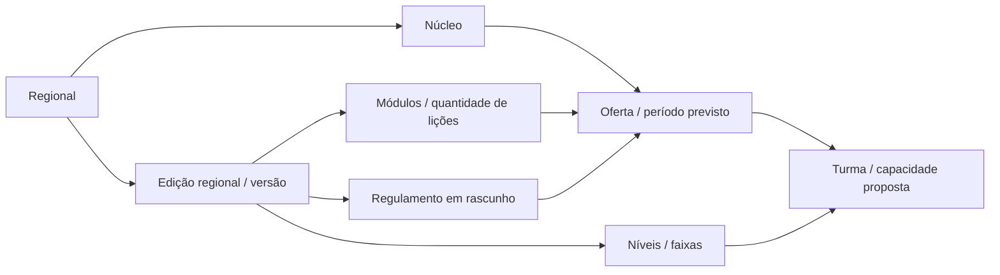

# T06 — Organização, currículo e turmas

**Estado:** Em validação técnica e institucional. **Data:** 14/11/2026. Esta entrega implementa a estrutura no Laravel e no PostgreSQL, com tela de cadastros locais. O uso real continua dependendo da autorização T07, do acesso restrito T08 e das decisões da F0 aplicáveis ao fluxo.

## 1. O que pode ser experimentado

Em [Organização e turmas](http://127.0.0.1:8001/estrutura), escolha a regional, busque uma turma pelo nome e filtre por núcleo. O cartão identifica regional, núcleo, nível, edição, oferta, período previsto e capacidade proposta. Turmas chamadas Sementes em Aurora/Jardim e Horizonte/Farol têm IDs diferentes; a consulta de uma regional não traz a turma da outra.

Há oito formulários: regional, núcleo, edição, nível, módulo, regulamento, oferta e turma. Eles enviam ao Laravel, validam no servidor e persistem no PostgreSQL. Recarregar a página preserva os registros. As prévias `/identidade-visual` e `/jornadas` continuam usando seus próprios exemplos; a T06 não converte ciência, chamada ou entrega da T04 em operações reais.

Os componentes `x-ui.*`, ícones e gradientes suaves foram reutilizados. O seletor compartilhado agora também aceita erro e o associa ao campo. Os campos mantêm 16 px; rótulos/botões, 14 px; apoio, pelo menos 12 px. No celular há acesso direto a “Novo cadastro”, navegação em janela e uma coluna de conteúdo.

Capturas da execução: [computador](estrutura-desktop.jpg) e [celular](estrutura-mobile.jpg). O cadastro “Turma de avaliação visual” é fictício e foi incluído no banco de demonstração para conferir o envio e sua persistência; ele não é adicionado pelo seeder.

## 2. Modelo implementado



| Registro | Identidade e vínculos | Garantia principal |
|---|---|---|
| `regions` | Código único, nome e fuso IANA | Contexto explícito para os demais cadastros |
| `local_units` | Regional, código e nome | Código único dentro da regional |
| `curriculum_editions` | Regional dona, código, versão, nome e referência | Código/versão únicos por regional; estado rascunho |
| `levels` | Regional/edição, código, ordem, idade mínima/máxima | Ordem/código únicos na edição; limites válidos e sem sobreposição de faixas na mesma edição |
| `curriculum_modules` | Regional/edição, código, ordem e quantidade de lições | Identidade por edição e contagem positiva |
| `pedagogical_rules` | Regional/edição e versão | Rascunho sem corte, transição, 29/02 ou vigência escolhidos automaticamente |
| `module_offerings` | Regional/núcleo/edição/módulo/regulamento, período, fuso e capacidade | Módulo e regulamento pertencem à mesma edição/regional; início efetivo permanece vazio |
| `classrooms` | Oferta, regional/núcleo/edição herdados, nível, código, nome e capacidade | Oferta e nível são compatíveis; nome pode se repetir em outras unidades |

A edição tem dona regional explícita nesta entrega. Um futuro catálogo nacional poderá fornecer a referência de origem para uma adoção regional versionada; a T06 não publica nem distribui um currículo nacional oficial.

## 3. Proteção no servidor e no banco

`CreateStructureRecord` aceita apenas os campos previstos para cada cadastro. Na criação de turma, regional é o contexto local selecionado; núcleo e edição são derivados da oferta, não aceitos de campos ocultos extras. Nível, módulo, regulamento e opções relacionadas são conferidos dentro da regional e edição correspondentes. Erros conhecidos retornam em português sem expor SQL.

O PostgreSQL também verifica as relações por **chaves estrangeiras compostas**: trocar apenas o ID de regional, núcleo, edição, oferta ou nível não produz um registro válido. Excluir uma referência em uso ou mudar o núcleo de regional com ofertas vinculadas é recusado. Restrições `CHECK` protegem estado de rascunho, datas, quantidades, faixas e identidade dos registros.

Uma restrição de exclusão GiST impede faixas etárias sobrepostas por edição. Ela usa os tipos de intervalo nativos para a edição e as idades, sem depender de `btree_gist` ou de permissão para instalar extensão. A integridade é aplicada pelo banco, inclusive fora do formulário; não é uma consulta prévia seguida de gravação sem proteção. [Restrições do PostgreSQL 17](https://www.postgresql.org/docs/17/ddl-constraints.html).

`ClassroomDirectory` exige a regional e confere o núcleo opcional dentro dela. A busca trata `%` e `_` como caracteres literais, usa parâmetros e retorna até 100 turmas por consulta. Os seletores usam IDs e identificam os contextos; nomes não funcionam como chave de vínculo.

**Limite desta entrega:** selecionar regional não comprova permissão. A entrada HTTP é uma ferramenta temporária de desenvolvimento, protegida por ambiente, opção explícita, acesso de loopback e base local dedicada. Não há autenticação/RBAC de participantes implementados. Na T07, a regional deverá vir de uma atribuição vigente verificada e Policies deverão proteger consultas e ações, inclusive contagens, filtros, URL direta e componentes Livewire.

## 4. Decisões pedagógicas preservadas

O seeder usa as faixas escolhidas pelo usuário: N1 2–5, N2 6–8, N3 9–11 e N4 12–17 anos. A escolha não decide data de corte, remanejamento, vigência ou edição completa. Todas as edições, regulamentos, ofertas e turmas permanecem em **rascunho**; o banco recusa sua ativação nesta etapa.

Os regulamentos criados pela tela começam com decisões e vigência vazias. Uma edição em rascunho pode estar incompleta: a T06 impede sobreposição, mas a conferência de cobertura completa, aprovação, publicação e imutabilidade de versão adotada entrará antes da matrícula real. Não há enquadramento automático por idade.

As datas de fevereiro–abril de 2027, 12 lições, capacidades de 25/50 e nomes do cenário são exemplos, sem confirmação de calendário, lotação ou conteúdo oficial. Capacidade é planejamento; ainda não há matrícula, ocupação de vaga ou soma operacional de vagas por oferta. T10 implementará essas regras após as decisões pertinentes.

## 5. Executar no Windows com PostgreSQL isolado

Requisitos: PHP/Composer/npm da aplicação, extensão `pdo_pgsql`, **PowerShell 7** e binários PostgreSQL **17.12** utilizados nesta execução. O [site oficial do PostgreSQL para Windows](https://www.postgresql.org/download/windows/) aponta para os [arquivos de binários da EDB](https://www.enterprisedb.com/download-postgresql-binaries). O runtime não integra o repositório.

O auxiliar `sistema/scripts/local-postgres.ps1` usa por padrão os binários em `%LOCALAPPDATA%/IBUC/postgresql-17.12/pgsql/bin`. Se já houver uma instalação compatível, informe `-PostgresBin` com a pasta dos executáveis; ele prepara seu próprio cluster, sem usar o banco de outro projeto.

Na raiz do repositório, depois de instalar as dependências Laravel e compilar o frontend conforme o README:

```powershell
# Use um processo separado: a configuração não altera o .env existente.
pwsh -NoProfile -File ./sistema/scripts/local-postgres.ps1 -Action Prepare
pwsh -NoProfile -File ./sistema/scripts/local-postgres.ps1 -Action Serve
```

Abra [http://127.0.0.1:8001/estrutura](http://127.0.0.1:8001/estrutura). `Prepare` migra e adiciona o cenário fictício; não apaga a base nem recria contas de usuário. `Serve` fica executando no terminal até Ctrl+C. O seeder também pode ser chamado explicitamente por `php artisan db:seed --class=StructureDemoSeeder` **depois** de configurar uma base local dedicada válida.

| Recurso do auxiliar | Configuração |
|---|---|
| Dados, logs e custódia local | `%LOCALAPPDATA%/IBUC/structure-development`, fora do OneDrive e do Git |
| Escuta do banco | `127.0.0.1:55432` por padrão; `-Port` altera a porta do cluster dedicado |
| Demonstração | Banco/papel `ibuc_structure_demo` |
| Testes | Banco/papel `ibuc_structure_test`, separado da demonstração |
| Credenciais | Geradas localmente, cifradas por DPAPI para a conta Windows e guardadas no diretório restrito; não impressas ou versionadas |
| Papéis da aplicação | Sem superusuário, criação de base ou criação de papel; conexão cruzada entre demo/test recusada |
| Navegador | Loopback, sessão em arquivo para CSRF/retorno do formulário, cache em memória e e-mails interceptados |

O auxiliar confere o diretório do cluster antes de preparar bancos e recusa configuração Laravel em cache. Ele não registra serviço do Windows, altera DNS ou acessa o Hetzner. `Stop` encerra o PostgreSQL dedicado, preservando os dados:

```powershell
pwsh -NoProfile -File ./sistema/scripts/local-postgres.ps1 -Action Stop
```

Em outra estação, mantenha desenvolvimento e testes separados, sem `DB_URL` sobrepondo o destino. A entrada HTTP só aceita PostgreSQL de loopback nos bancos `ibuc_structure_demo`/`ibuc_structure_test`, ambiente `local`/`testing` e `IBUC_STRUCTURE_DEMO=true`; a opção é desativada por padrão. Em produção, as rotas `/estrutura` não são registradas.

## 6. Conferir a entrega

```powershell
# Raiz do repositório: suíte completa com a conexão dedicada de teste.
pwsh -NoProfile -File ./sistema/scripts/local-postgres.ps1 -Action Test

# Dentro de sistema/: frontend e estilo.
npm test
php vendor/bin/pint --test
npm run build
php artisan view:cache
php artisan route:list --env=production --path=estrutura --json
```

O teste do banco confere driver, host, ausência de URL substituta e nome real do banco antes de migrar. Os casos usam transações revertidas ao final; não executam limpeza sobre um banco compartilhado. `php artisan test` sem o ambiente de PostgreSQL isolado informa os casos T06 como **ignorados**, não como integridade aprovada em SQLite. A migração T06 exige PostgreSQL explicitamente.

As verificações abrangem criação dos oito registros, seeder repetido, homônimos, busca literal, campos extras, referências incompatíveis entre regionais e entre edições da mesma regional, atualização/exclusão de referências, faixas sobrepostas, valores inválidos, ativação recusada, entrada local protegida e reversão/reaplicação da migração em transação isolada. O exercício de backup/restauração T13 ainda não foi feito.

**Resultado desta execução:** 39 testes PHP, com 345 asserções, passaram no ambiente PostgreSQL dedicado. Os 10 testes Node das jornadas, o build Vite, a compilação Blade e a formatação Pint também passaram. A listagem de rotas de produção para `/estrutura` retornou `[]`.

No navegador foram conferidos cadastro persistido, busca da turma depois de navegar entre regionais, erro de faixa com foco e descrição, filtros de opções e menu móvel com Escape/retorno do foco. Os oito formulários foram medidos em 320 px; a tela de turma também em 390, 768 e 1440 px, sem rolagem horizontal. Textos medidos: 16/14/12 px; campos e botões principais: mínimo 48 px. Nenhum aviso/erro de console foi observado na inspeção final. Leitor de tela real, ampliação de texto a 200%, rede limitada, Android físico e aceite da equipe continuam pendentes.

## 7. Continuidade

- [x] Modelo, integridade PostgreSQL, consulta por regional e oito formulários locais implementados.
- [x] Cenário fictício reutilizável, testes de servidor/banco e conferência responsiva executados.
- [ ] Decisões institucionais aplicáveis e avaliação com a equipe registradas.
- [ ] T07: atribuições, vigência, contexto autorizado e Policies, negando por padrão.
- [ ] T08–T12: acesso restrito, representação, matrícula e colaboradores.
- [ ] T13/T14: auditoria, recuperação ensaiada e acervo privado.

O próximo ID é **T07**. Ele não deve transformar esta entrada local em administração pública ou usar o seletor de regional como credencial. Os detalhes do Hetzner podem ser incorporados quando o usuário os fornecer, conforme a T05.
